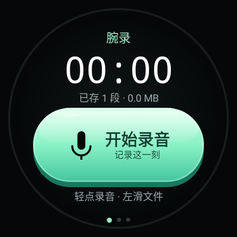
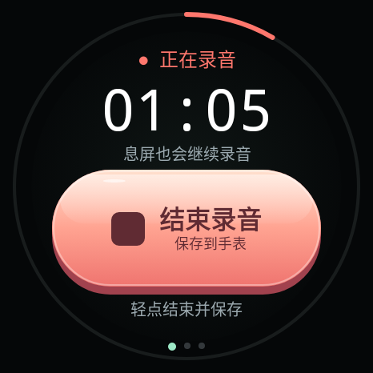
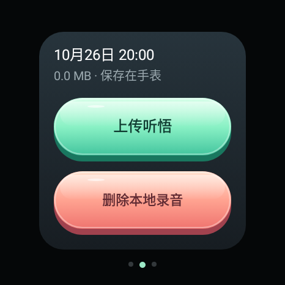
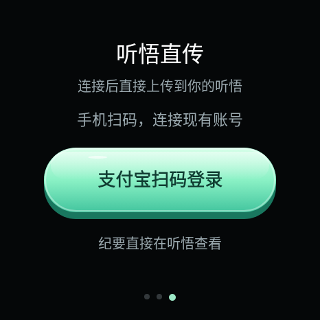
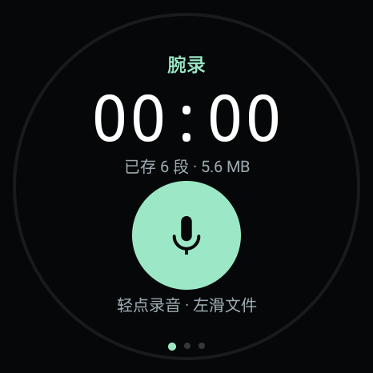
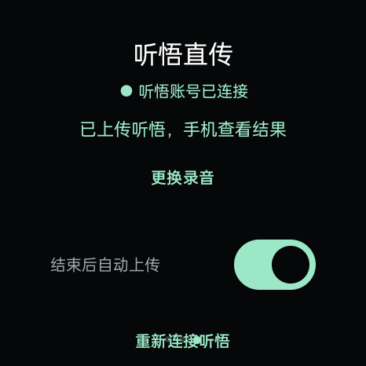
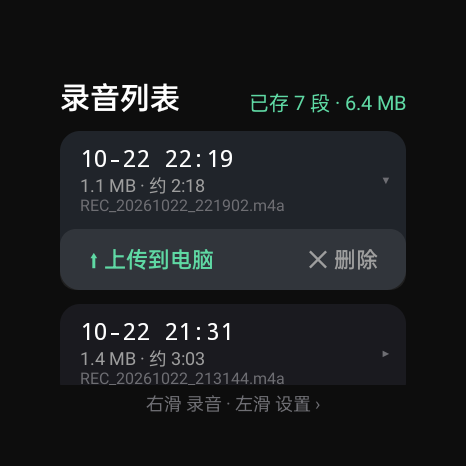
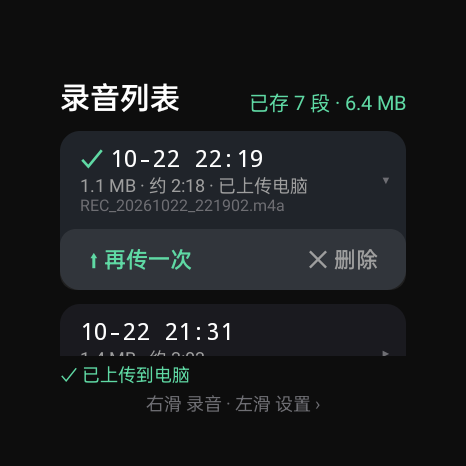
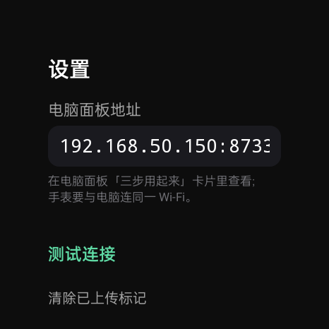

# 腕录 WanLu 2.3 — 手表录音，听悟转写，电脑管理纪要

> 电脑工作台版本为 2.3，手表端更新为 2.2.2：圆形麦克风图标、卡通光泽立体按钮和更大的触控区域。支持普通听悟账号扫码登录，录音直接上传听悟。

**手表录音，通过手机共享网络直接上传你现有的通义听悟账号。日常不需要电脑中转，也不需要手机手动接收录音、导入文件或另外配置百炼 Key。**

新版针对 OPPO Watch 圆屏重新设计：深色背景、大计时器、带高光与按压下沉反馈的宽胶囊录音 / 停止按钮。三页分别为录音、本地文件和听悟直传；转写和纪要在手机听悟查看。主按钮为约 168 × 78 dp，其他主要按钮至少高 52 dp；薄荷绿表示主要操作，珊瑚色用于停止 / 删除，蓝灰色用于次要操作。

### 手表 2.2.2 界面

[下载手表 2.2.2 安装包](https://github.com/athlonk8/wanlu-watch-minutes/releases/tag/watch-v2.2.2)。同签名覆盖安装保留原录音；旧预览包签名不同，不要为更换图标或按钮而直接卸载它。

以下为 466 × 466 的 Android 原生布局渲染图，使用合成静音文件；录音状态仅展示按钮与计时样式，未启动麦克风或上传。它们不代替真机功能验收，详见 [截图说明](docs/screenshots/watch-v222/README.md)。

| 开始录音 | 结束并保存（状态示意） |
| --- | --- |
|  |  |

| 文件操作 | 听悟扫码入口 |
| --- | --- |
|  |  |

### 电脑端听悟工作台 2.3

电脑面板沿用你现有的通义听悟账号，直接管理云端任务、查看转写和会议纪要，无需百炼 Key。支持读取手表 2.2 的私有录音目录、备份到电脑、本地音频导入，以及主动确认后上传到听悟。

Windows 用户在 [Releases](https://github.com/athlonk8/wanlu-watch-minutes/releases) 下载安装包或便携 ZIP，双击“腕录”使用；自带 Python、Node 与 ADB。首次使用通过官方窗口登录原来的听悟账号。

支持上传进度与取消、断线恢复、云端改名、回收站删除和恢复，以及带版本检查的原文 / 纪要编辑。从源码运行的方法见下方使用文档。

详见 [听悟工作台使用与验证](docs/pc-panel.md)。已实测账号任务、转写 / 纪要读取、合成音频上传和云端编辑管理；网页兼容协议仍属实验性适配，可能随官网更新而变化。旧百炼面板保留在 `/legacy`，作为可选工具。

```text
Android 手表 ──借用手机网络直接上传──> 现有通义听悟账号 ──> 手机查看
```

- 首次在手表打开“支付宝扫码登录”，用支付宝确认官方登录；登录过期时重新扫码。
- 在文件列表选择录音，点“上传听悟”，第三页确认上传。可开启“结束后自动上传”，只处理之后新录制并保存的录音。
- 上传和处理失败都会保留手表原件；恢复任务时先核对已有云端记录，避免重复创建。
- 已配对手机共享的网络继续正常使用，无需为上网专门开启热点。
- 标准蓝牙文件发送和同 Wi-Fi 临时网页下载仅作为备用，见 [备用传输指南](docs/phone-tingwu.md)。
- 接入复用听悟官网的登录与上传流程，属于实验性网页兼容适配，未开通或调用开发者 API。官网改版可能需要更新适配；听悟账号自身额度和存储规则适用。
- 直传验证细节见 [听悟直传记录](docs/tingwu-direct-status.md)。
- 仓库中的 `pipeline/cloud_server.py`、Docker Compose 与 [云端部署指南](docs/cloud-deploy.md) 属于保留的可选开发者后端，普通听悟账号方案不需要它们。

2.2 历史实机验证截图（用于说明此前的直传验证，当前按钮样式见上方 2.2.2）：

| 2.2 待机 | 2.2 听悟直传 |
| --- | --- |
|  |  |

[2.0 的历史验证记录](docs/verification-v2.md)；当前直传状态以以上 2.2 说明为准。

从源码构建：JDK 17+、Android SDK 35，在 `watchrec_app` 目录运行 `.\gradlew.bat -PwanluPreview=true :app:assembleDebug`。APK 输出到 `watchrec_app/app/build/outputs/apk/debug/app-debug.apk`。预览包可与原版并存；安装覆盖升级前请确认签名匹配并备份已有录音，不要为安装新版直接卸载旧版。

验证后端：`python -m unittest discover -s pipeline/tests -v`。测试不调用真实付费 API。

---

## 旧版 1.x 电脑面板说明（兼容保留）

下文截图和电脑中转操作属于旧版，当前操作以以上 2.2 说明为准。旧 PC 工具仍可独立使用。

为 **OPPO Watch X3**（国行 ColorOS Watch / Android 底）开发的自用方案，同样适用于其他可 sideload APK 的 Android 手表。转写与纪要全部走**阿里云百炼 API**（paraformer-v2 + qwen-plus），本地不做任何模型推理。


## 功能一览

| 能力 | 说明 |
| --- | --- |
| 🎙 手表圆环按键录音 | 分段粗圆环(开始=薄荷绿渐变弧 / 结束=珊瑚红弧,字嵌弧带内),内圈细环走分钟进度,息屏不断录 |
| 📂 手表录音列表 | 表上左滑查看全部录音(开始时间/大小/估算时长),点行展开「上传/删除」,两击确认删除,录音中禁止管理 |
| ⬆️ 手表手动上传 | 手表经 Wi-Fi 把录音**手动**直传电脑面板(仅传文件到本地,绝不自动解析/自动上传);已传的带 ✓ 标记 |
| 🖥 电脑遥控录音 | 面板大按钮遥控手表启停,顶栏红点实时显示录音状态 |
| 🔐 上传与否由你决定 | 录音先拉取到本地(免费);勾选后点上传,先确认**解析参数**(会议主题/说话人分离/语种/转写与纪要模型)再调用 API |
| 🧑‍🤝‍🧑 说话人分离 | paraformer-v2 diarization,转写自动标注 说话人A/B/时间戳 |
| 📝 结构化会议纪要 | 主题/参会人/要点/决议/待办表格/风险,LLM 生成,面板直接渲染 |
| 📱 纪要发手机 | adb 推送到手机 `Download/腕录纪要/`,可自动弹出分享面板转发微信 |
| ☁️ 纪要云同步 | 钉钉群机器人/飞书群机器人/自定义 Webhook,支持加签 |
| 🎛 参数全可视化 | API Key、转写模型、说话人分离、纪要模型(百炼/智谱GLM)全部界面控件 |

## 工作原理

```
┌─────────────┐   adb    ┌──────────────────────────────┐
│  OPPO 手表   │ ───────► │  PC 控制面板 (localhost:8733)  │
│  腕录 v1.5   │ ◄──遥控── │  Python 标准库,零额外服务       │
└─────────────┘          └──────────┬───────────────────┘
  AAC 64kbps m4a                    │ 你确认后上传
  息屏不断录(前台服务)                ▼
                          ┌──────────────────────────────┐
                          │  阿里云百炼                    │
                          │  paraformer-v2 转写+说话人分离  │
                          │  qwen-plus 生成会议纪要        │
                          └──────────┬───────────────────┘
                                     │
                    ┌────────────────┼────────────────┐
                    ▼                ▼                ▼
              面板查看/下载      手机 Download      钉钉/飞书群
```

## 界面截图

**手表端 v1.5(三页 · 分段粗圆环 · 扁平设计)** — 第 1 页录音(上弧「开始」薄荷绿渐变,下弧「结束」录音时点亮珊瑚红,字嵌在弧带里,内圈细环为分钟进度);左滑第 2 页录音列表(手动上传/删除);再左滑第 3 页设置:

| ① 待机 | ② 录音 10 秒 | ③ 录音 30 秒 | ④ 停止后 |
| --- | --- | --- | --- |
|  |  |  |  |

| ⑤ 左滑:录音列表 | ⑥ 点行展开,出现「⬆上传/✕删除」 | ⑦ 点 ✕ 变「确认删」,再点删除 |
| --- | --- | --- |
|  |  |  |

| ⑧ 点「⬆ 上传到电脑」→ ✓ 已上传 | ⑨ 再左滑:设置页(填面板地址) |
| --- | --- |
|  |  |

**PC 控制面板** — 手表遥控、录音勾选、接收手表直传、上传前参数确认、任务进度、结果渲染:


**纪要分发与百炼设置** — 全部表单控件,保存即生效:


## 使用指南(图文)

### 手表端

**① 开始录音** — 打开「腕录」,点上方薄荷绿环的「开始」(点弧带任意位置都行,不用瞄字):


**② 录音中** — 中央计时走秒,内圈细环顺时针走满一圈 = 1 分钟;此时下环「结束」点亮珊瑚红:


**③ 停止** — 点下环「结束」,录音自动保存为 `REC_日期_时间.m4a`;待机界面显示已存段数与占用:


**④ 管理录音** — 主页**左滑**进入录音列表:每段显示开始时间、大小、估算时长;**点一行展开**「⬆ 上传到电脑 / ✕ 删除」;删除需两击确认(点 ✕ 变红「确认删」,再点才删,3 秒不点自动取消):

| 录音列表 | 点行展开 | 确认删 |
| --- | --- | --- |
|  |  |  |

> 录音进行中列表页会提示「停止后可管理」;圆屏上内容都控制在安全区内,不会被表圈裁切。

**⑤ 手表手动上传(可选)** — 手表连上与电脑相同的 Wi-Fi,再左滑到**设置页**,填入面板地址(电脑面板「三步用起来」卡片里有),点「测试连接」确认 ✓;回列表页展开录音,点「**⬆ 上传到电脑**」,录音经 Wi-Fi 直传到面板本地(带 ✓ 已上传标记)。**只有你点了才传,APP 绝不自动上传、传过去也只是落盘待解析,不产生任何 API 费用**:

| 设置页 | 上传成功 ✓ |
| --- | --- |
|  |  |

### 电脑端(面板)

**⑥ 打开面板** — 手表放底座用 USB 连电脑,双击 `pipeline\启动面板.bat`,浏览器开 `http://127.0.0.1:8733`。

**⑦ 遥控与拉取** — 「手表录音」卡片可直接远程开始/停止;「录音文件」勾选后点「⇩ 拉取选中到本地」(**免费**,不碰 API)。

**⑧ 上传解析(此时才计费)** — 切到「本地待解析」勾选录音,点「☁ 上传百炼解析」,先弹出参数表单:填**会议主题**(选填,会作为纪要主题依据)、选语种/说话人分离/转写与纪要模型,点「确认上传解析」:


**⑨ 查看与分发** — 任务完成后在「解析结果」里切换转写/纪要/原始 JSON;纪要可「📱 发到手机」(adb 推到 Download)、「☁ 云同步」(钉钉/飞书机器人)或「⇩ 下载.md」:


## 快速开始

### 1. 安装手表端「腕录」

APK 在 [Releases](../../releases) 下载,或用本仓库源码自行构建(见下文)。

1. 手表开启开发者模式:**设置 → 关于手表 → 连点"版本号"7 次**,再到 开发者选项 打开 **ADB 调试**
2. 手表与电脑连同一 WiFi,电脑执行 `adb connect 手表IP:5555`
   (部分 OPPO 手表不支持无线 ADB,可改用手机端「甲壳虫 ADB」类工具安装;
   安装被拦截时在开发者选项关闭"安装验证")
3. `adb install -r 腕录-WatchRec-v1.5.apk`,首次打开允许麦克风权限

### 2. 启动 PC 控制面板

```bash
cd pipeline
pip install -r requirements.txt   # 只需要 requests
python server.py                  # 或双击 启动面板.bat
# 浏览器打开 http://127.0.0.1:8733
```

### 3. 配置百炼 API

到 [阿里云百炼控制台](https://bailian.console.aliyun.com) 创建 **API-KEY**(新用户有免费额度),
填进面板右侧「百炼 API 设置」→ 保存。一场 1 小时会议的转写+纪要成本约几毛钱。

### 4. 日常三步

1. **录音** — 面板或表盘点「开始」,结束时点「结束」
2. **取回** — 「录音文件」勾选 → 拉取到本地(不产生费用)
3. **解析** — 勾选本地录音 → 「上传百炼解析」→ 完成后在结果区查看/发手机/云同步

## 从源码构建手表 APK

```bash
cd watchrec_app
gradlew.bat :app:assembleDebug    # 需 JDK 17+ / Android SDK 35
# 产物: app/build/outputs/apk/debug/app-debug.apk
```

技术栈:Kotlin + Jetpack Compose,前台服务(`foregroundServiceType="microphone"`)+ PARTIAL WakeLock 保证息屏录音,`MediaRecorder` AAC 64kbps 单声道(约 28MB/小时,单段上限 4 小时)。

## 纪要分发配置

| 目标 | 配置方法 |
| --- | --- |
| 手机 | 手机 USB 连电脑并开 USB 调试;纪要推送到 `Download/腕录纪要/`,可勾选推送后自动弹出分享面板 |
| 钉钉群 | 群设置 → 机器人 → 添加"自定义"机器人,安全设置选**加签**,Webhook 和 SEC 密钥填入面板,点「测试连接」 |
| 飞书群 | 群设置 → 群机器人 → Custom Bot,Webhook 填入面板(开了签名校验则填密钥) |
| 自定义 | 向你的 URL `POST {"title","content","source"}` JSON,可接 n8n/自建服务 |

## 注意事项

- **录音合规**:会议录音请遵守公司规定并告知参会人
- **腕上录音的物理局限**:手表戴手腕上离发言人远、袖口易蹭麦;重要会议建议摘下手表放在靠近发言人的位置
- **续航**:纯录音耗电很低(屏幕可息屏),1 小时会议实测约消耗 10~20% 电量
- 未上传的录音永远只留在本地;`pipeline/config.ini`(含 Key)已被 .gitignore 排除

## 目录结构

```
├─ apk/                        成品 APK(发布页)
├─ watchrec_app/               手表端源码 (Kotlin + Compose)
├─ pipeline/
│  ├─ server.py                控制面板后端 (Python 标准库, 端口 8733)
│  ├─ static/index.html        控制面板前端 (单文件, 无构建依赖)
│  ├─ minutes.py               转写+纪要核心模块 (CLI 可独立使用)
│  ├─ 启动面板.bat / 拉取录音.bat / 生成纪要.bat
│  └─ config.example.ini       配置模板
├─ docs/screenshots/           截图
└─ inbox/ out/                 运行时目录(自动创建)
```

## 已验证 / 未验证

- ✅ 模拟器:录音生成有效 m4a、电脑遥控启停、圆环 UI 视觉验收
- ✅ 一加真机:纪要 adb 推送到 Download(中文文件名正常)
- ✅ Webhook:本地接收器端到端(钉钉/飞书消息体已按官方格式构造)
- ✅ OPPO Watch X3 **真机**:v1.5 三页 UI、录音/停止、列表两击删除、**手表 Wi-Fi 直传电脑**(1.1MB 实测落盘 inbox)、面板遥控启停、上传前参数表单全部实测通过
- ✅ 上传仅手动:APP 无任何自动上传逻辑,`/api/watch_push` 只落盘不解析
  (连接提示:手表 USB 调试需开启并放授权;息屏状态下遥控启动可能被系统拦截,面板已做先唤醒处理)

## License

[MIT](LICENSE) · 仅供学习交流,请合规使用录音与 AI 服务
