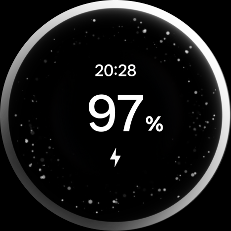
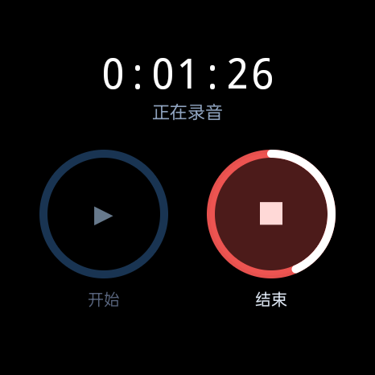

# 腕录 WanLu — OPPO 手表录音 → AI 会议纪要

**手表一键录音，回到电脑自动转写成带说话人标注的文稿，并生成结构化会议纪要，一键发手机或同步到钉钉/飞书群。**

为 **OPPO Watch X3**（国行 ColorOS Watch / Android 底）开发的自用方案，同样适用于其他可 sideload APK 的 Android 手表。转写与纪要全部走**阿里云百炼 API**（paraformer-v2 + qwen-plus），本地不做任何模型推理。


## 功能一览

| 能力 | 说明 |
| --- | --- |
| 🎙 手表圆环按键录音 | 表盘「开始 ▶ / 结束 ■」描边圆环按键,录音中结束环带白色分钟进度弧+呼吸光晕,息屏不断录 |
| 🖥 电脑遥控录音 | 面板大按钮遥控手表启停,顶栏红点实时显示录音状态 |
| 🔐 上传与否由你决定 | 录音先拉取到本地(免费);只有你勾选并确认后才上传百炼解析 |
| 🧑‍🤝‍🧑 说话人分离 | paraformer-v2 diarization,转写自动标注 说话人A/B/时间戳 |
| 📝 结构化会议纪要 | 主题/参会人/要点/决议/待办表格/风险,LLM 生成,面板直接渲染 |
| 📱 纪要发手机 | adb 推送到手机 `Download/腕录纪要/`,可自动弹出分享面板转发微信 |
| ☁️ 纪要云同步 | 钉钉群机器人/飞书群机器人/自定义 Webhook,支持加签 |
| 🎛 参数全可视化 | API Key、转写模型、说话人分离、纪要模型(百炼/智谱GLM)全部界面控件 |

## 工作原理

```
┌─────────────┐   adb    ┌──────────────────────────────┐
│  OPPO 手表   │ ───────► │  PC 控制面板 (localhost:8733)  │
│  腕录 v1.2   │ ◄──遥控── │  Python 标准库,零额外服务       │
└─────────────┘          └──────────┬───────────────────┘
  AAC 64kbps m4a                    │ 你确认后上传
  息屏不断录(前台服务)                ▼
                          ┌──────────────────────────────┐
                          │  阿里云百炼                    │
                          │  paraformer-v2 转写+说话人分离  │
                          │  qwen-plus 生成会议纪要        │
                          └──────────┬───────────────────┘
                                     │
                    ┌────────────────┼────────────────┐
                    ▼                ▼                ▼
              面板查看/下载      手机 Download      钉钉/飞书群
```

## 界面截图

**手表端(圆环按键)** — 左:待机;右:录音中(结束环高亮+白色分钟进度弧):

| 待机 | 录音中 |
| --- | --- |
|  |  |

**PC 控制面板** — 手表遥控、录音勾选、上传确认、任务进度、结果渲染:


**纪要分发与百炼设置** — 全部表单控件,保存即生效:


## 快速开始

### 1. 安装手表端「腕录」

APK 在 [Releases](../../releases) 下载,或用本仓库源码自行构建(见下文)。

1. 手表开启开发者模式:**设置 → 关于手表 → 连点"版本号"7 次**,再到 开发者选项 打开 **ADB 调试**
2. 手表与电脑连同一 WiFi,电脑执行 `adb connect 手表IP:5555`
   (部分 OPPO 手表不支持无线 ADB,可改用手机端「甲壳虫 ADB」类工具安装;
   安装被拦截时在开发者选项关闭"安装验证")
3. `adb install -r 腕录-WatchRec-v1.2.apk`,首次打开允许麦克风权限

### 2. 启动 PC 控制面板

```bash
cd pipeline
pip install -r requirements.txt   # 只需要 requests
python server.py                  # 或双击 启动面板.bat
# 浏览器打开 http://127.0.0.1:8733
```

### 3. 配置百炼 API

到 [阿里云百炼控制台](https://bailian.console.aliyun.com) 创建 **API-KEY**(新用户有免费额度),
填进面板右侧「百炼 API 设置」→ 保存。一场 1 小时会议的转写+纪要成本约几毛钱。

### 4. 日常三步

1. **录音** — 面板或表盘点「开始」,结束时点「结束」
2. **取回** — 「录音文件」勾选 → 拉取到本地(不产生费用)
3. **解析** — 勾选本地录音 → 「上传百炼解析」→ 完成后在结果区查看/发手机/云同步

## 从源码构建手表 APK

```bash
cd watchrec_app
gradlew.bat :app:assembleDebug    # 需 JDK 17+ / Android SDK 35
# 产物: app/build/outputs/apk/debug/app-debug.apk
```

技术栈:Kotlin + Jetpack Compose,前台服务(`foregroundServiceType="microphone"`)+ PARTIAL WakeLock 保证息屏录音,`MediaRecorder` AAC 64kbps 单声道(约 28MB/小时,单段上限 4 小时)。

## 纪要分发配置

| 目标 | 配置方法 |
| --- | --- |
| 手机 | 手机 USB 连电脑并开 USB 调试;纪要推送到 `Download/腕录纪要/`,可勾选推送后自动弹出分享面板 |
| 钉钉群 | 群设置 → 机器人 → 添加"自定义"机器人,安全设置选**加签**,Webhook 和 SEC 密钥填入面板,点「测试连接」 |
| 飞书群 | 群设置 → 群机器人 → Custom Bot,Webhook 填入面板(开了签名校验则填密钥) |
| 自定义 | 向你的 URL `POST {"title","content","source"}` JSON,可接 n8n/自建服务 |

## 注意事项

- **录音合规**:会议录音请遵守公司规定并告知参会人
- **腕上录音的物理局限**:手表戴手腕上离发言人远、袖口易蹭麦;重要会议建议摘下手表放在靠近发言人的位置
- **续航**:纯录音耗电很低(屏幕可息屏),1 小时会议实测约消耗 10~20% 电量
- 未上传的录音永远只留在本地;`pipeline/config.ini`(含 Key)已被 .gitignore 排除

## 目录结构

```
├─ apk/                        成品 APK(发布页)
├─ watchrec_app/               手表端源码 (Kotlin + Compose)
├─ pipeline/
│  ├─ server.py                控制面板后端 (Python 标准库, 端口 8733)
│  ├─ static/index.html        控制面板前端 (单文件, 无构建依赖)
│  ├─ minutes.py               转写+纪要核心模块 (CLI 可独立使用)
│  ├─ 启动面板.bat / 拉取录音.bat / 生成纪要.bat
│  └─ config.example.ini       配置模板
├─ docs/screenshots/           截图
└─ inbox/ out/                 运行时目录(自动创建)
```

## 已验证 / 未验证

- ✅ 模拟器:录音生成有效 m4a、电脑遥控启停、圆环 UI 视觉验收
- ✅ 一加真机:纪要 adb 推送到 Download(中文文件名正常)
- ✅ Webhook:本地接收器端到端(钉钉/飞书消息体已按官方格式构造)
- ✅ OPPO Watch X3 **真机**:底座 USB 连电脑安装成功,真机录音/息屏/圆环 UI(466×466 圆屏无裁切)/面板遥控启停全部实测通过
  (连接提示:手表 USB 调试需开启并放授权;息屏状态下遥控启动可能被系统拦截,面板已做先唤醒处理)

## License

[MIT](LICENSE) · 仅供学习交流,请合规使用录音与 AI 服务
