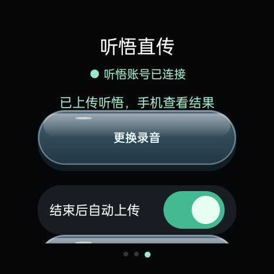

# 手机共享网络上传修复（2.2.5，2026-11-08）

用户反馈上传始终不成功，只有手机共享网络时连阿里登录页也无法打开。连接 OWW261 后确认当前为 2.2.4，使用手机蓝牙共享，系统联网验证已通过，原听悟登录仍有效。因此不能将本次上传故障归因于系统没有标记联网。

## 已确认的问题与修正

- 两条用户失败任务停在上传 100%，没有成功回执，旧链接已于 10 月 30 日过期。只读查询对应云端记录，均为 `status=2 / TRS.UploadingExpired`。重试前检查有效期；只有**原记录**明确为此错误时才重新建立上传，其他不确定状态仍先核对，已处理记录不重新上传。
- 16 MiB 填充的 1 秒静音 M4A 复现了整文件 PUT 的“发送 100% → 等回执 → 超时”。大于等于 1 MiB 的新上传改用听悟官网同类 STS 授权及 OSS Android SDK 2.9.21，256 KiB 顺序分片，保留私有目录中的断点。暂停后续传沿用原记录，完成后清除临时授权。不需要用户提供开发者 AccessKey 或百炼 Key。
- 1 秒静音样本在云端已完成，手表却曾报提交失败。观察到 `startTrans` 返回通用 `-1`、立即查询仍为待处理，稍后却已完成；修订为稍后只查询原记录，不重复创建或重复提交。

- 上传不再等待 WorkManager 对默认网络的 `VALIDATED` 判断，由后台任务访问实际听悟账号接口确认可达性。网络未接通时有限次退避重试，防止共享网络可以访问服务但系统联网判断未通过时一直排队。
- 账号核对成功后，迁移旧版本仍在排队的上传请求，仅更新其网络等待条件，保留任务 ID 和云端记录，不取消正在执行的请求。
- 请求正文尚未写入就失败时，恢复创建前状态，不再错误地要求用户先检查云端任务。正文发出后没有回执仍保留“不确定”的状态，避免盲目重复创建。
- 已有上传地址和云端记录的文件传输中断后，重试沿用原记录；不重新新建记录。转写提交回执不确定时仍先查询原记录。
- 网络错误细分为域名解析失败、超时、连接失败、安全连接失败。页面错误保留原官方地址，手动重试该页。没有关闭证书校验、导出账号 Cookie 或记录带签名的地址。
- 账号检查遇到服务故障或网络中断时保留本进程中已有的账号信息；只有明确的未登录响应才判定登录失效。
- “听悟直传”页增加“共享网络检查”，登录页底部也可点“查网络”：显示默认网络类型、系统联网判断、手表时间，分别以不携带账号 Cookie 的 HTTPS 请求检查听悟入口和阿里登录入口。HTTP 入口可达不代表其所有二维码资源或 OSS 文件上传成功。离开登录页时暂停轮询，避免与检查争抢共享网络。
- 慢网络下登录按钮可能在整页加载完成前就绪，现每 4 秒检查并打开已经就绪的听悟内嵌登录组件，避免重复点击已有弹层；不会定时刷新阿里二维码。二维码加载后更新扫码提示。
- 64 / 96 / 128 kbps 档位和默认 96 不变；不改动已有录音，不自动重建旧的不确定任务。

## 真机验证

1. 蓝牙共享、手机连接 Wi-Fi：16 MiB 填充样本完成上传，手表为 `done`，指定云端记录为 `status=0`。约 31% 暂停后续传，最终云端记录一致，临时授权与上传链接已清除。
2. 样本由 1 秒合成静音 AAC/M4A 加合法 MP4 `free` 区块构成，时长仍为 1 秒，文件为 16,778,397 字节。未录制或上传用户会议，不作为音质或识别准确率的证据。
3. 用户关闭手机 Wi-Fi 后，手机默认网络确认为 `CELLULAR`；手表仍经蓝牙共享，听悟及阿里登录入口均 HTTPS 200。另一个 16 MiB 样本完成分片上传并得到处理接受回执。
4. 在手表内置 WebView 中加载阿里官方登录页，移动数据经蓝牙共享下约 19 秒即检测到已渲染的二维码；当时文档仍为 `interactive`，尚未整页加载完成，未报告页面或资源错误。没有清除或导出原登录，也没有要求用户再次扫码。
5. 四个云端测试记录移入回收站，四个本地测试文件和临时诊断包清理；8 段用户原录音 SHA-256 一致，原自动上传开关保留。

旧版本成功的历史记录保留在 [听悟直传记录](tingwu-direct-status.md)，不作为本次故障已解决的证据。

## 本地验证

- `:app:assembleDebug :app:testDebugUnitTest :app:lintDebug` 通过，61 项测试、0 失败、0 错误。
- 新增覆盖：不依赖系统联网标记的调度；旧排队请求迁移后保留任务 ID 与云端记录；请求写入前失败可安全重试；请求发出后超时不盲目重建；上传中断保留原记录；服务故障不误报登出；明确登录过期时才清除本进程账号状态。
- 安装包签名与此前正式包一致，已覆盖安装。SDK 使用 HTTPS、系统 DNS，禁止重定向与 HTTPDNS；临时授权只保存在应用私有目录。分片授权限制、延迟确认和严格匹配旧过期记录均有测试；真实续传以以上真机验证为证据。

Android 官方说明：[网络状态与验证](https://developer.android.com/develop/connectivity/network-ops/reading-network-state)、[WebView 页面错误回调](https://developer.android.com/reference/android/webkit/WebViewClient)。本项目设备是 ColorOS Watch，仍需在其实际手机共享实现上验证，不能直接以其他 Wear OS 设备的行为推断兼容性。
